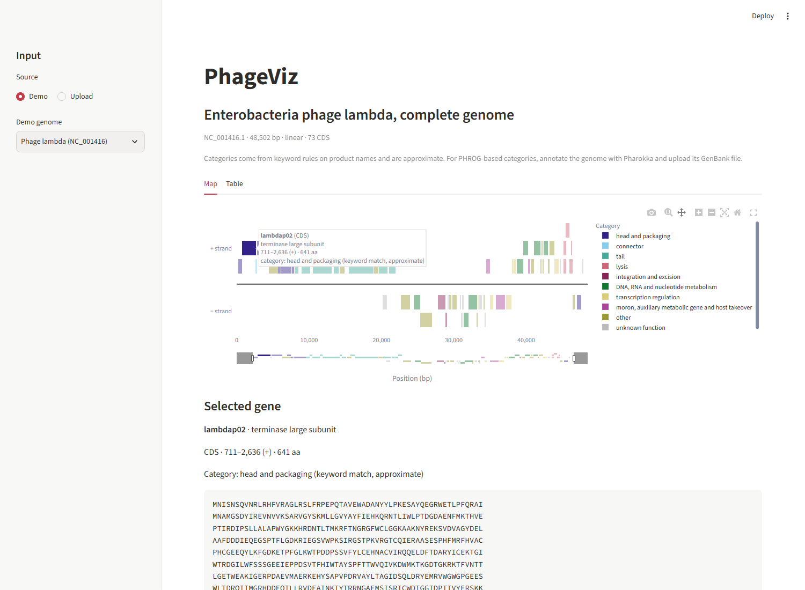

# PhageViz

**Interactive bacteriophage genome annotation viewer, built with Streamlit.**

Load a phage genome from a file or straight from NCBI and see it as an interactive map coloured
by gene function. Click any gene to see its coordinates, category and protein sequence, or search
the gene table.

> **Status: in development, milestone 2 of 5 complete.** The core viewer and NCBI fetch/search
> work today. Analysis tabs, more input formats and exports are planned; see
> [Roadmap](#roadmap) for what's done and what isn't.



*Phage lambda (NC_001416): genes on the + strand above the axis and the − strand below, coloured
by functional category. Clicking the terminase large subunit (gene A) shows its details and
protein sequence.*

> **Live demo:** planned for milestone 5.

---

## Roadmap

| Milestone | Scope | Status |
|---|---|---|
| **M1: Core viewer** | Data model, GenBank parser, demo genomes, genome map, gene table, click-to-inspect | **Done** |
| **M2: NCBI** | Fetch by accession, search by name, caching, error handling, secrets | **Done** |
| **M3: Analysis** | GC content and GC skew tracks, Summary tab, hallmark-gene check, category filter | Planned |
| **M4: Raw input and export** | FASTA upload with gene prediction, GFF3 upload, CSV / FASTA / SVG / PNG downloads | Planned |
| **M5: Polish and ship** | Genome rotation, GenBank export, CI, Docker, public deployment | Planned |

### Features

**Loading a genome**
- [x] One-click demo genomes: phage lambda, T7 and T4
- [x] Upload a GenBank file (`.gb`, `.gbk`, `.gbff`), optionally gzipped, with several records per file
- [x] Pharokka GenBank output: PHROG categories read from the `function` qualifier
- [x] Clear error messages for unreadable, empty or unsupported files
- [x] Fetch from NCBI by accession, e.g. `NC_001604` (size checked before downloading)
- [x] Search NCBI by phage name, with RefSeq reference genomes listed first
- [x] Clear messages for unknown or protein accessions, oversized records, and NCBI outages
- [ ] Upload FASTA and predict genes with `pyrodigal` (M4)
- [ ] Upload GFF3 with an embedded sequence (M4)

**Exploring**
- [x] Strand-aware gene map coloured by functional category (colour-blind-safe palette)
- [x] Overlapping genes stacked into rows so none are hidden
- [x] Zoom and pan with a range slider
- [x] Click a gene to see its product, coordinates, length, category and protein sequence
- [x] Searchable gene table (product or locus tag)
- [x] Keyword-based categories clearly labelled as approximate
- [ ] GC content and GC skew tracks (M3)
- [ ] Summary tab: GC%, coding density, % hypothetical, strand bias (M3)
- [ ] Hallmark-gene check: terminase, portal, capsid, endolysin, holin, integrase (M3)
- [ ] Filter the map and table by category (M3)
- [ ] Rotate the genome to start at a chosen gene (M5)

**Exporting**
- [ ] Gene table as CSV (M4)
- [ ] Protein sequences as FASTA (M4)
- [ ] Map as SVG or PNG (M4)
- [ ] Genome as GenBank, including predicted genes and rotation (M5)

---

## Quick start

Requires **Python 3.10+**.

```bash
git clone https://github.com/<your-username>/phageviz.git
cd phageviz
python -m venv .venv
source .venv/bin/activate          # Windows: .venv\Scripts\activate
pip install -r requirements.txt    # add requirements-dev.txt for tests and linting
streamlit run app.py
```

The app opens at `http://localhost:8501` with phage lambda loaded.

### NCBI access (optional)

NCBI asks every user of its E-utilities for an email address. To enable the **NCBI** source,
create `.streamlit/secrets.toml`:

```toml
[ncbi]
email = "you@example.com"
api_key = ""   # optional: raises the limit from 3 to 10 requests per second
```

A free API key is available in your NCBI account settings. **Never commit `secrets.toml`**; it is
already in `.gitignore`. Without it the app still runs, and the NCBI option shows these
instructions instead.

## Usage

1. Choose **Demo**, **Upload** or **NCBI** in the sidebar.
2. For NCBI, type an accession (`NC_001604`) and click **Fetch**, or type a name
   (`Escherichia phage T7`), click **Search**, pick a result and click **Fetch**.
3. If an uploaded file holds more than one record, pick one.
4. **Map** tab: hover over a gene for a summary, click it for full details and its protein
   sequence (with a copy button).
5. **Table** tab: search by product name or locus tag.

---

## Engineering notes

Things this project gets right that are easy to get wrong:

- **One data model for every input.** Every source becomes a `GenomeRecord` that validates itself
  on creation (column types, coordinates, strands, unique IDs), so plotting and export code never
  has to check where data came from.
- **Coordinates.** Internal positions are 1-based and inclusive, converted once from Biopython's
  0-based half-open locations. Genes that cross the origin of a circular genome are stored
  "unwrapped" (end beyond the genome length) so `start ≤ end` always holds.
- **Biology details.** Genes starting with alternative start codons (GTG, TTG) are translated with
  methionine first, except for genes marked as 5'-partial. Lambda's own gene A starts with GTG.
- **Safe display of user data.** Product names and record titles are escaped before they reach
  Markdown or chart tooltips; unexpected errors show a generic message and are logged without
  user data.
- **NCBI done carefully.** The record size is checked before downloading, so a bacterial
  chromosome is refused in one small request. Searches list RefSeq reference genomes first
  (NCBI's own order buried the T7 reference genome). Requests time out after 30 s instead of
  hanging, failed fetches aren't retried on every page refresh, and results are cached.
- **Tests.** 343 offline tests at the end of M2 with 100% line coverage of `src/`, checked
  against the real lambda, T7 and T4 records and against real NCBI replies (recorded once, then
  replayed offline). Key code was also mutation-tested (deliberately broken to make sure a test
  fails).

Design decisions are recorded in [docs/SPEC.md](docs/SPEC.md); requirements are in
[docs/PRD.md](docs/PRD.md).

---

## Inputs and limits

| Input | Formats | Status |
|---|---|---|
| Annotated genome | GenBank (`.gb`, `.gbk`, `.gbff`), optionally gzipped | Supported |
| Pharokka output | GenBank with `phrog` / `function` qualifiers | Supported |
| NCBI accession or name | RefSeq (`NC_001416`) or GenBank (`J02459`), or a phage name | Supported |
| Raw genome | FASTA (`.fa`, `.fasta`, `.fna`) | M4 |
| GFF3 | With an embedded `##FASTA` section | M4 |

Limits: 50 MB upload, 1,000–1,000,000 bp per genome, first 50 records per file. The format is
detected from the file's content, not its extension.

## Project structure

```
phageviz/
├── app.py                  # Streamlit UI (widgets, tabs, caching, error display)
├── pyproject.toml          # package metadata, ruff and pytest settings
├── requirements.txt        # pinned runtime dependencies
├── requirements-dev.txt    # + pytest, pytest-cov, ruff
├── .streamlit/config.toml  # theme, upload limit, no tracebacks in the browser
├── data/demo/              # lambda, T7, T4 GenBank files (RefSeq)
├── scripts/
│   ├── fetch_demo.py              # one-off download of the demo genomes
│   └── capture_ncbi_fixtures.py   # records real NCBI replies for offline tests
├── src/phageviz/
│   ├── models.py           # GenomeRecord and the features schema
│   ├── parsers.py          # GenBank parsing (GFF3 and FASTA in M4)
│   ├── ncbi.py             # NCBI summary, search and fetch via Bio.Entrez
│   ├── annotation.py       # functional categories (hallmarks in M3)
│   ├── plots.py            # Plotly genome map
│   └── errors.py           # user-facing error types
├── tests/                  # mirrors src/; synthetic fixtures in tests/data/
└── docs/                   # PRD.md, SPEC.md, screenshot
```

Planned modules: `metrics.py` (M3), `gene_calling.py`, `exporters.py` (M4),
`transforms.py` (M5).

## Testing

```bash
pip install -r requirements-dev.txt
pytest -q                                   # fast tests (~20 s)
pytest -q -m "not network"                  # all offline tests, incl. full-page app tests
NCBI_EMAIL=you@example.com pytest -m network   # live NCBI checks (optional)
pytest --cov=src --cov-report=term-missing  # with coverage
ruff check . && ruff format --check .       # lint
```

## Limitations

- Keyword-based categories are approximate. For publication-quality annotation, run
  [Pharokka](https://github.com/gbouras13/pharokka) and upload its GenBank output.
- GenBank files without annotated genes can't be shown until gene prediction arrives (M4).
- Genetic code 11 is used by default.
- NCBI fetch and search depend on NCBI's availability and rate limits.

## Data sources and credits

- **NCBI Nucleotide** via E-utilities and Biopython `Bio.Entrez`
- **NCBI RefSeq** records for the demo genomes (lambda NC_001416.1, T7 NC_001604.1, T4 NC_000866.4)
- **PHROGs** functional categories (Terzian et al., 2021, *NAR Genomics and Bioinformatics*)
- **Biopython** (Cock et al., 2009, *Bioinformatics*)
- Colour palette: Paul Tol's "muted" colour-blind-safe scheme

## License

MIT (license file to be added).
